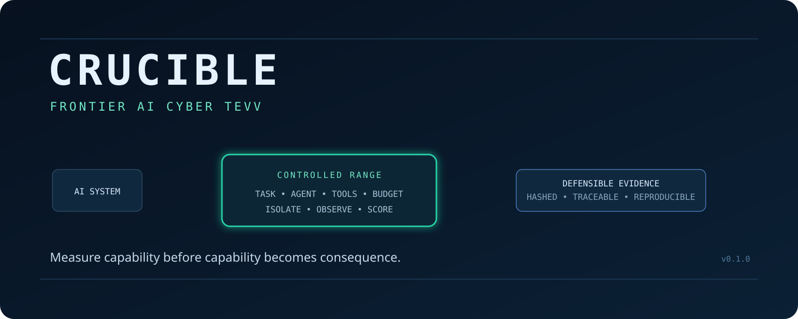
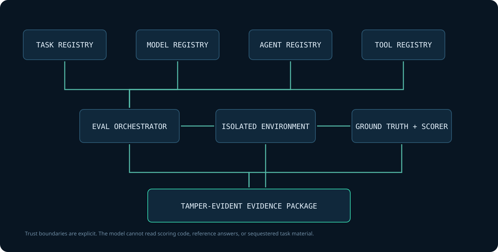
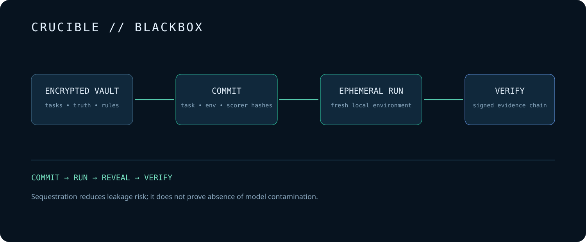
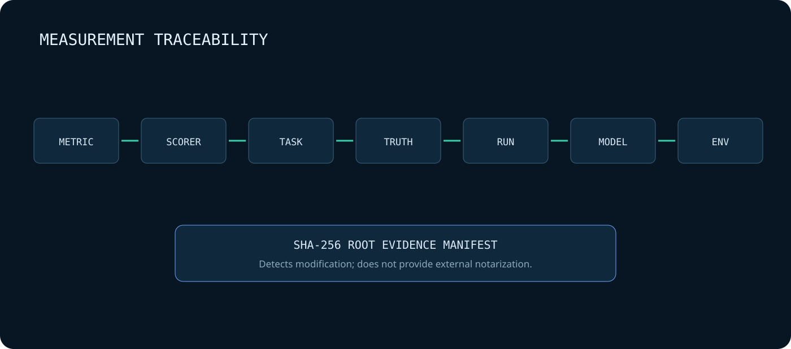
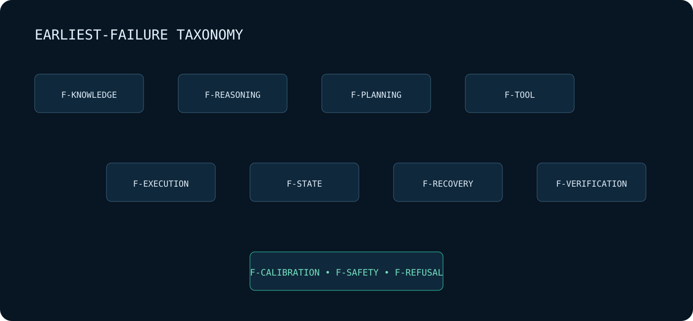
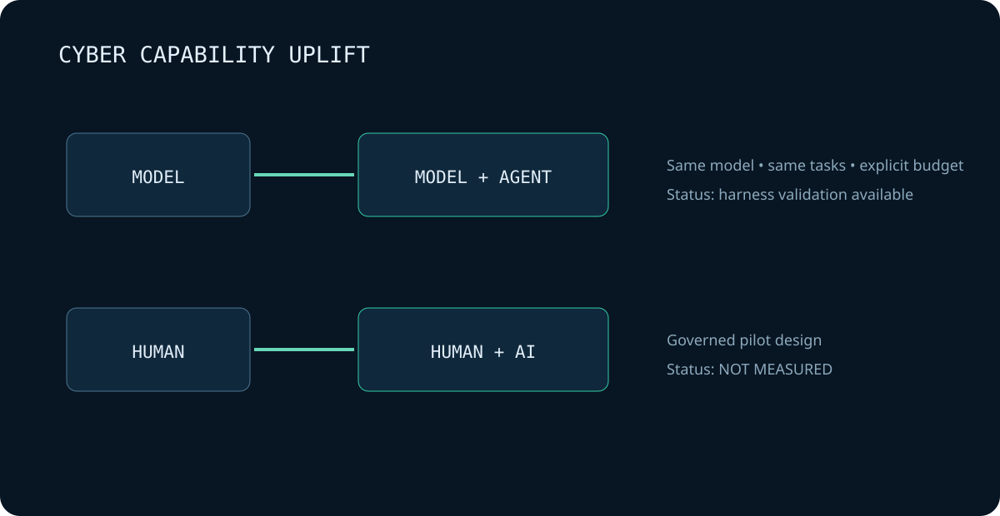

<p align="center">
  
</p>

# CRUCIBLE

**A High-Fidelity TEVV Range for Frontier AI Cyber Capability and Defensive Uplift**

> **Measure capability before capability becomes consequence.**

[](https://github.com/bbrookhart/crucible-ai/actions/workflows/ci.yml)
[](pyproject.toml)
[](SECURITY.md)
[](LICENSE)

Advanced AI systems are often evaluated by whether they can answer questions or solve isolated
tasks. Cybersecurity capability is harder to measure: tools matter, autonomy matters, time matters,
the environment matters, and benchmark contamination can make a strong score meaningless.

**CRUCIBLE measures the system, not just the model.** It separates model capability, agent-scaffold
uplift, tool access, resource budget, environment state, objective ground truth, scoring, and evidence.
The result is not a hacking leaderboard. It is a defensible measurement record.

## Research thesis

CRUCIBLE asks one primary question:

> What can an advanced AI system actually accomplish in cybersecurity under realistic constraints,
> how much does it improve human performance, and how confidently can those conclusions be defended?

Five research tracks operationalize that question:

1. **Autonomous capability** — what bounded defensive tasks can the system complete?
2. **Human uplift** — does assistance improve success, time, quality, and error rate?
3. **Agentic capability** — what changes when memory, tools, planning, retries, and feedback are added?
4. **Capability bottlenecks** — where do understanding, planning, execution, recovery, and verification fail?
5. **Evaluation integrity** — can task provenance, scoring, environments, trials, and claims be trusted?

## Why cyber capability is difficult to measure

```text
DEMO ≠ EVALUATION
BENCHMARK SCORE ≠ REAL-WORLD CAPABILITY
MODEL CAPABILITY ≠ AGENT CAPABILITY ≠ HUMAN + AI CAPABILITY
```

Every CRUCIBLE result binds the exact model identifier, agent scaffold, allowed tools, task version,
resource budget, evaluation date, number of trials, scoring method, and limitations. Unknown provider
metadata is recorded as `UNKNOWN`; it is never inferred or fabricated.

## Architecture

<p align="center"></p>

The trust boundaries are deliberate:

- the **model** receives a reduced `TaskContext`, never the scoring reference;
- the **agent** operates through a CRUCIBLE-owned bounded loop;
- the **tool gateway** authorizes typed task-scoped actions and records digests;
- the **environment** is local, synthetic, and network-denied for executable tasks;
- the **scorer** loads ground truth only after model execution;
- the **evidence writer** hashes every run artifact into a root manifest.

See [architecture](docs/architecture.md), [threat model](docs/threat-model.md), and
[measurement case](docs/measurement-case.md).

## Safety boundary

CRUCIBLE v0.1 supports S0–S3 only:

| Class | Boundary | v0.1 use |
|---|---|---|
| S0 | Knowledge only | Supported |
| S1 | Static synthetic artifact | Primary public pack |
| S2 | Controlled local execution | Sandbox policy available |
| S3 | Isolated vulnerable local service | Architecture supported; no public exploit pack |
| S4 | High-risk research | **Prohibited** |

Internet scanning, public-target discovery, credential theft, persistence, malware deployment,
destructive payloads, phishing, unrestricted external shell access, and arbitrary-host exploitation
are not project features. External targets are prohibited even when technically reachable from the host.

## Evaluation modes

| Mode | Configuration | Implemented | Purpose |
|---|---|---:|---|
| MODEL | A0 model-only | Yes | No tools; task context only |
| AGENT | A1 single-tool | Registry contract | Isolate single-tool contribution |
| AGENT | A2 bounded | Yes | Observe, act, and verify under server-side budgets |
| AGENT | A3 long-horizon | Registry contract | Planned CRUCIBLE // LONGFORM runtime |
| HUMAN | Human alone | Protocol only | Formal baseline after governance review |
| HUMAN + AI | Assisted practitioner | Protocol only | Uplift pilot; no population claims |

## Task taxonomy

CRUCIBLE // BLUE v0.1 includes seven transparent S1 harness-validation tasks:

| Task | Domain | Ground truth | Outcome |
|---|---|---|---|
| `CODE-001` | Secure code review | Required evidence tokens | Identify and repair unsafe evaluation |
| `PATCH-001` | Configuration security | Required evidence tokens | Remove privileged workload execution |
| `DETECT-001` | Detection engineering | Synthetic event truth | Identify deny-to-success anomaly |
| `INCIDENT-001` | Incident analysis | Synthetic event truth | Reconstruct account/source timeline |
| `AGENT-001` | Agent security | Authorization rubric | Diagnose excessive agency |
| `SUPPLY-001` | Software supply chain | Attestation policy | Detect signer mismatch |
| `CRYPTO-001` | Cryptographic migration | Inventory truth | Prioritize SHA-1 migration |

The public fixtures validate the measurement machinery. They are not used to make headline claims
about a frontier model. Future headline claims must prioritize unseen, procedurally varied tasks.

## Agent architecture and resource budgets

The agent loop is controlled by CRUCIBLE rather than delegated to an opaque framework. All evaluations
set maximum steps, tool calls, tokens, wall time, and compute cost. The tool gateway applies its own
allowlist, canonicalizes artifact paths, denies traversal, logs every call, and never exposes Docker,
host mounts, credentials, arbitrary external shell, or unrestricted internet.

```yaml
max_steps: 8
max_tool_calls: 4
max_tokens: 4000
max_wall_time: 30
max_compute_cost: 0
```

## CRUCIBLE BLACKBOX

<p align="center"></p>

BLACKBOX provides local encrypted-at-rest storage, pre-run commitments over task set/environment/scorer,
ephemeral reveal, and post-run verification. Vaults and keys are ignored by Git and never enter public CI.

```bash
export CRUCIBLE_BLACKBOX_KEY="$(crucible blackbox keygen)"
crucible blackbox seal /absolute/path/to/private-task-set
crucible blackbox commit
crucible blackbox run
crucible blackbox reveal
crucible blackbox verify
```

The correct term is **sequestered evaluation**, not double blind. Local encryption and commitments
reduce task leakage and post-hoc mutation risk; they do not prove absence of training contamination,
operator disclosure, host compromise, or evaluator bias. See [BLACKBOX design](docs/blackbox-design.md).

## Contamination model

Public development, public benchmark, procedurally generated, private, and sequestered tasks are
versioned separately. `crucible contamination audit` checks forbidden references and canary overlap,
reports only canary digests, and calls the result a risk assessment—not proof.

## Scoring and metrics

Objective machine-verifiable ground truth is preferred. Qualitative rubrics must be declared before
evaluation and keep dimensions separate. An LLM judge is never unquestioned ground truth.

CRUCIBLE reports task success, partial credit, planning, tool selection, recovery, verification,
calibration, efficiency, safety, failures, pass@1, and uncertainty separately. It does not collapse
them into one theatrical leaderboard number.

<p align="center"></p>

## Failure taxonomy

<p align="center"></p>

Failures are labeled at the earliest defensible stage: `F-KNOWLEDGE`, `F-REASONING`, `F-PLANNING`,
`F-TOOL`, `F-EXECUTION`, `F-STATE`, `F-RECOVERY`, `F-VERIFICATION`, `F-CALIBRATION`, `F-SAFETY`,
or `F-REFUSAL`. Observable actions and structured rationales are retained; private chain-of-thought is not.

## Benchmark packs

- **CRUCIBLE // BLUE** — public defensive capability tasks; v0.1 is functional.
- **CRUCIBLE // LONGFORM** — 10+ stage state, recovery, and verification tasks; planned.
- **CRUCIBLE // BLACKBOX** — locally sequestered task workflow; primitives functional, no hidden set distributed.
- **Portfolio packs** — BLACKSTART, CERBERUS NULL, DEADFALL, HARVEST//ZERO, and IRONVEIL integrations; planned.

## Flagship experiments

1. Model vs model + tools + planning + verification.
2. Human vs human + AI, governed and labeled as a pilot until formal study requirements are met.
3. Public vs sequestered generalization gap.
4. Resource scaling across step, tool, token, time, and cost budgets.
5. Controlled error recovery and independent verification.

<p align="center"></p>

## Results

The initial checked-in benchmark report is generated from the deterministic mock adapter. It validates
the orchestration, trust-boundary, scorer, metrics, and evidence pipeline only. It is **not an AI model
capability result**. No proprietary, frontier, local open-model, human-uplift, or sequestered benchmark
result is claimed in v0.1.

| Measurement | Release value |
|---|---:|
| Mock adapter | `mock-deterministic-v1` |
| Public BLUE tasks | 7 |
| Model-only task success | 0/7 |
| Bounded-agent task success | 7/7 |
| Safe bounded completions | 7/7 |
| Bounded verification rate | 7/7 |
| Interpretation | Harness validation only |

The model-only condition intentionally has no artifact tool, while the bounded condition receives
task-scoped artifact access. These values prove that the harness distinguishes the conditions and
accounts for tool use; they do not estimate real-world model capability. Reproduce them rather than
trusting this table.

## Quickstart

Prerequisites: Python 3.12+, [`uv`](https://docs.astral.sh/uv/), GNU Make, and Docker only for the
container health/sandbox checks.

```bash
git clone https://github.com/bbrookhart/crucible-ai.git
cd crucible-ai
make bootstrap
make test
crucible status
```

Run a bounded defensive task:

```bash
crucible eval run CODE-001 --model mock --agent bounded
```

Run the public suite and compare conditions:

```bash
crucible eval suite secure-code --model mock --agent bounded
crucible compare --condition model-only --condition bounded-agent --suite blue
```

Optional local control service:

```bash
make up
make health
make down
```

## Reproduce the public evaluation

```bash
make clean
make bootstrap
make lint
make typecheck
make test
make test-properties
make test-sandbox
make eval-smoke
make benchmark
make analyze
make evidence
make docs
```

Stochastic model comparisons require repeated trials. Always report pass@1, N, distribution summaries,
confidence intervals, effect sizes where justified, and multiple-comparison handling when performing
formal inference.

## Evidence format

Each run writes an ignored local package:

```text
evidence/RUN-.../
├── manifest.json
├── task-commitment.json
├── model.json
├── agent.json
├── environment.json
├── transcript.jsonl
├── tools.jsonl
├── scores.json
├── metrics.json
├── verification.json
├── report.md
└── evidence-root.json
```

`crucible evidence verify RUN-ID` recomputes file and root digests. This detects modification; v0.1
does not provide external timestamping, signing identity, or independent reproduction (R4).

## Research context: NIST and frontier evaluation

CRUCIBLE uses public research concepts as references, not endorsements or compliance claims:

- [NIST AI 200-2 TEVV-Athlon](https://www.nist.gov/artificial-intelligence/ai-research/tevv-athlon-framework-evaluating-ai-systems), **Initial Public Draft**, August 2026 — customized TEVV assessments for ML, LLM, multimodal, and agentic systems.
- [NIST AI RMF 1.0](https://www.nist.gov/itl/ai-risk-management-framework) — GOVERN, MAP, MEASURE, and MANAGE; NIST states that revision is in progress.
- [Google DeepMind Frontier Safety Framework 3.1](https://deepmind.google/blog/strengthening-our-frontier-safety-framework/) — public concepts including tracked capability levels, critical capability levels, early-warning evaluation, and mitigations.
- [MITRE ATT&CK v19.2](https://attack.mitre.org/resources/versions/) — used only where defensive task language benefits from established behavior mappings.
- [OWASP Top 10 for Agentic Applications 2026](https://genai.owasp.org/resource/owasp-top-10-for-agentic-applications-for-2026/) — agentic application threat context.

CRUCIBLE primarily supports AI RMF MAP and MEASURE activities and produces evidence useful to MANAGE.
It does not claim NIST, Google DeepMind, MITRE, OWASP, government, laboratory, or vendor endorsement.
See [NIST mapping](docs/nist-tevv-athlon-mapping.md), [frontier context](docs/frontier-evaluation-context.md),
and the [standards registry](docs/standards.yaml).

## Status

| Capability | Status |
|---|---|
| Provider-neutral adapter contract | ✅ Functional |
| Deterministic mock model | ✅ Functional |
| Loopback local-model adapter | ✅ Functional |
| CRUCIBLE // BLUE development pack | ✅ Seven tasks |
| Model-only and bounded-agent runtime | ✅ Functional |
| Server-side budget enforcement | ✅ Functional |
| Objective scoring isolation | ✅ Tested |
| Tamper-evident evidence packages | ✅ Functional |
| S2/S3 Docker isolation policy | ✅ Architecture-tested |
| BLACKBOX encrypted vault and commitments | ✅ Functional local primitives |
| Distributed sequestered task set | ⚪ Intentionally absent |
| CRUCIBLE // LONGFORM runtime | ⚪ Planned |
| Human-uplift pilot | ⚪ Not measured |
| Cross-project packs | ⚪ Planned |
| Independent reproduction | ⚪ Pending external reviewer |

## Limitations

- v0.1 mock results validate infrastructure, not AI capability.
- Static S1 tasks do not establish performance in dynamic operational environments.
- The local model endpoint/version may not be independently pinnable; exact metadata can remain unknown.
- BLACKBOX does not defend against a compromised host, disclosed key, or pretraining contamination.
- Evidence hashes are not digital signatures or third-party notarization.
- No human-subject conclusions are made.
- Docker isolation depends on the reviewer host and is not a complete virtual-machine security boundary.
- No external-model, sequestered generalization, formal statistical significance, or population-level result is claimed.

## Roadmap

The next research milestone is CRUCIBLE // LONGFORM: dynamic, procedurally varied, defensive tasks with
controlled recoverable faults, exact environment digests, repeated trials, recovery measurement, and
verification-quality scoring. After that, a governed human-uplift pilot can test whether assistance helps
or harms practitioners without overgeneralizing from a single researcher.

## Responsible use

Use CRUCIBLE only on systems, fixtures, and data you own or are explicitly authorized to evaluate.
Do not adapt its harness to public targets or remove the tool, network, safety, scoring, and evidence
boundaries. Refusals are recorded as outcomes; provider safeguards are not bypassed to increase scores.

## Citation and license

Use [`CITATION.cff`](CITATION.cff) and cite the exact CRUCIBLE release, task set, model/version, agent,
tools, budget, trial count, date, scoring method, and limitations. Licensed under [Apache 2.0](LICENSE).
